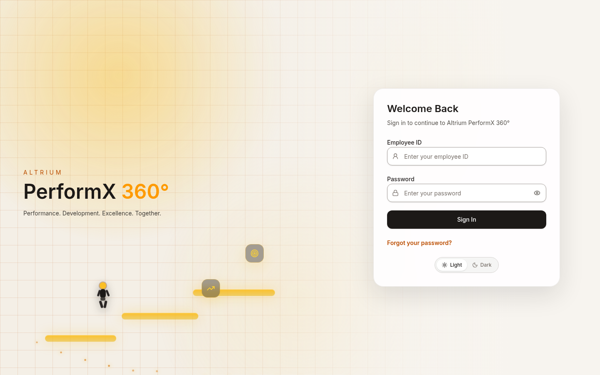
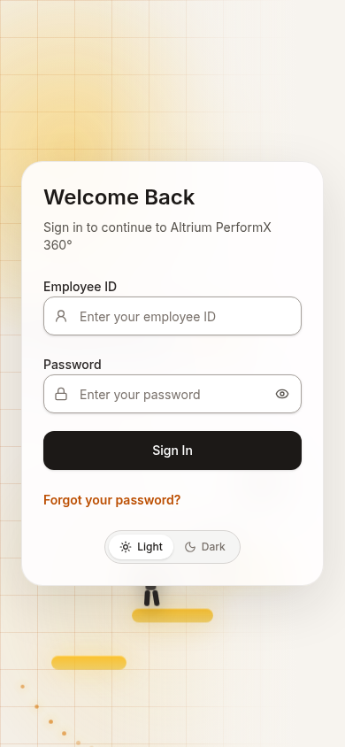
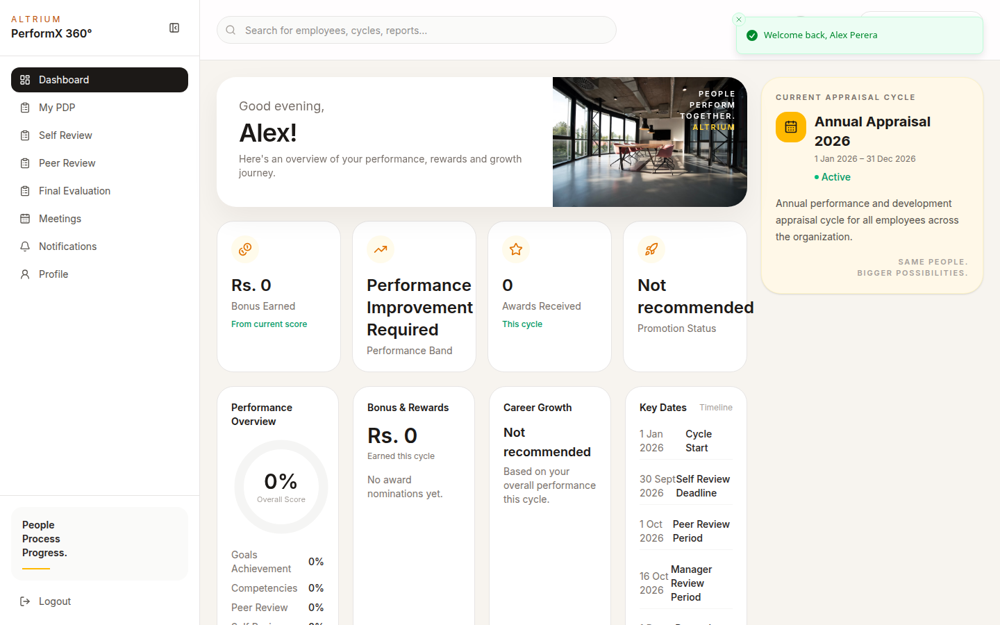
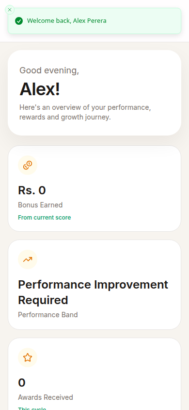
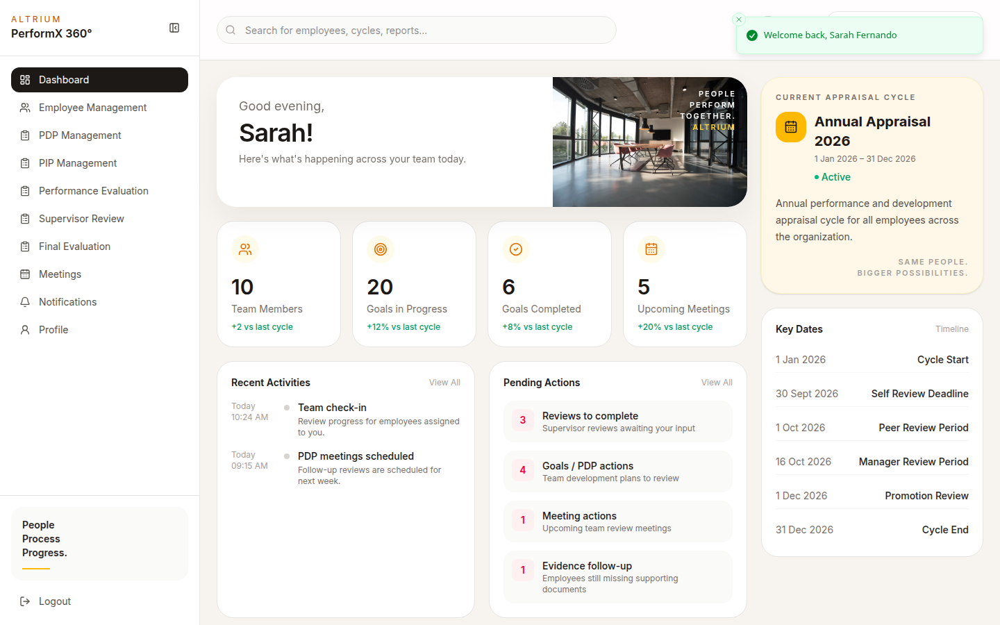
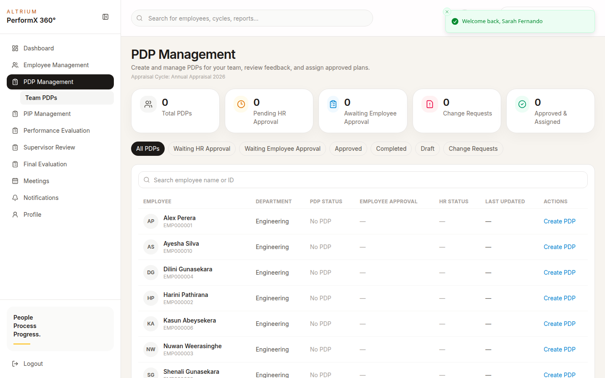
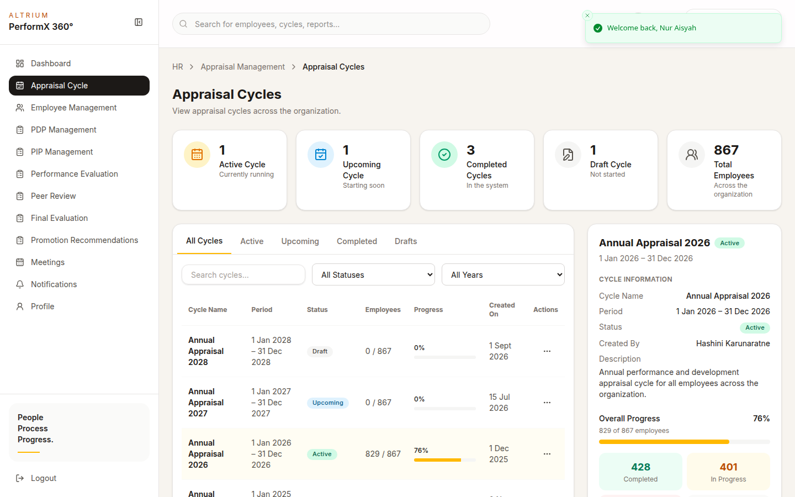
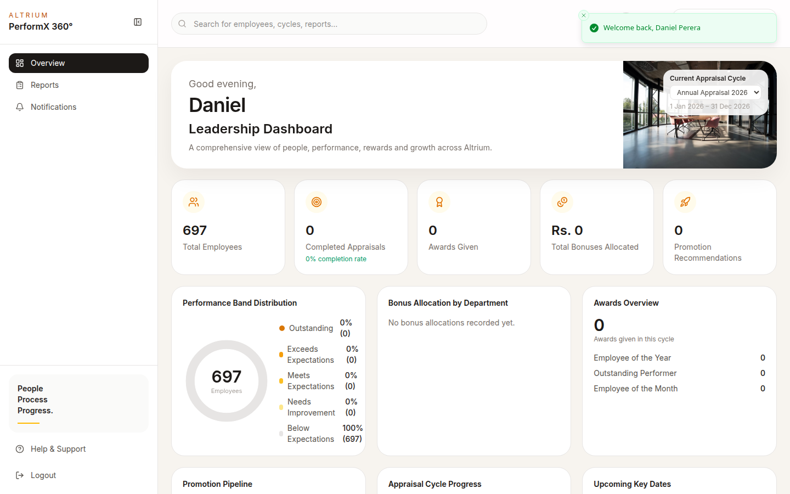
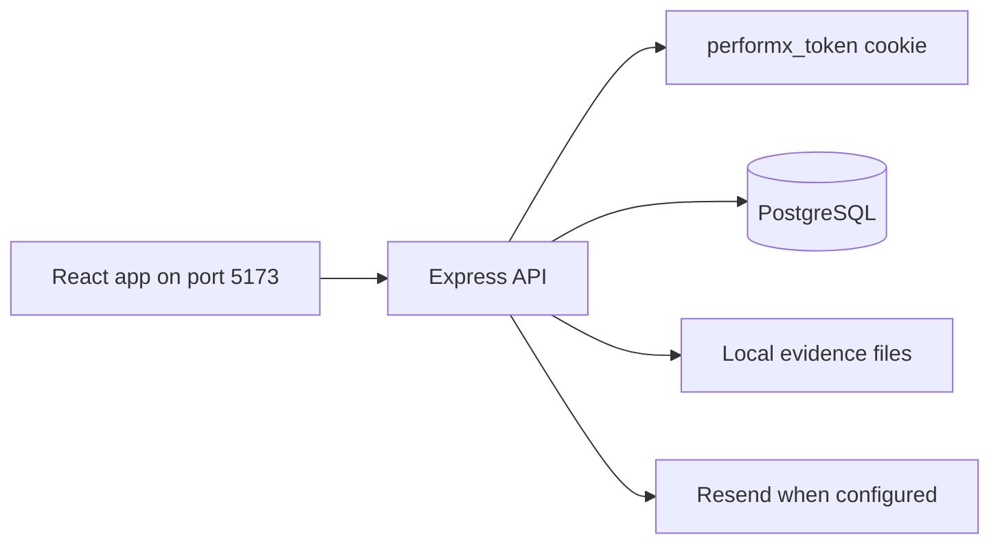
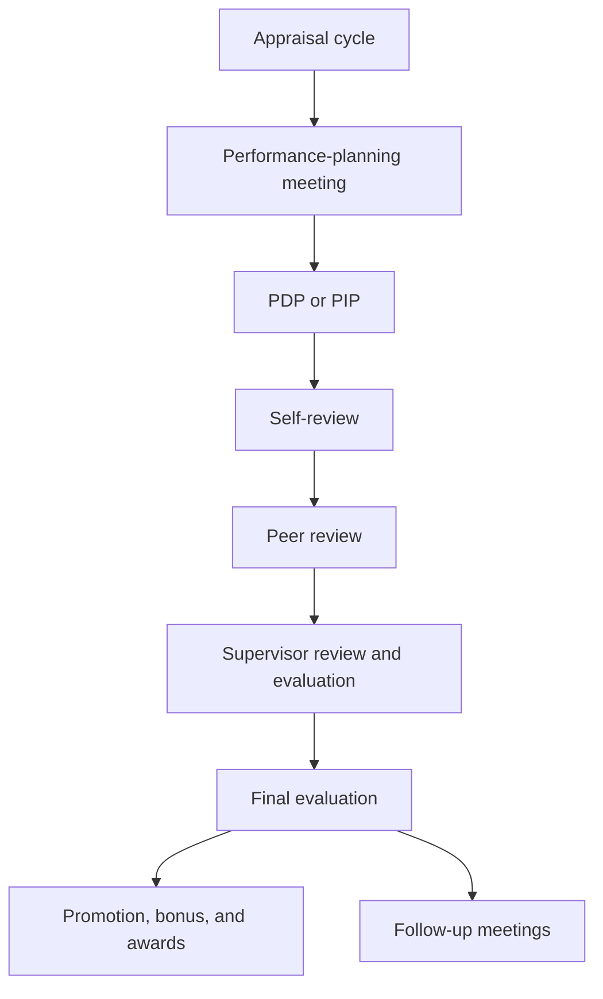

# PerformX 360

PerformX 360 is the performance and development system for Altrium. Employees, supervisors, HR, and leadership share one appraisal cycle, from planning through rewards.

## Overview

The repository is a separate React frontend and Express backend. People sign in with an employee ID. The API keeps the session in an HTTP-only cookie and returns role-specific dashboards, plans, reviews, and reports. PostgreSQL, accessed through Prisma 7, stores the organisation, appraisal cycles, and workflow records.

This was a team project. The Git history published in this repository is under the `roshelpeter-cpu` account, and the repository does not include a file that splits features by person. The sections below describe what the current frontend and backend implement. They are a map of the product, not a claim that one author built every workflow.

## Links

| Resource | Location |
| --- | --- |
| Repository | [github.com/roshelpeter-cpu/performx-360](https://github.com/roshelpeter-cpu/performx-360) |
| Frontend | `frontend/` |
| Backend | `backend/` |
| Deployment shape | `vercel.json` sends `/api` to the backend service and other paths to the Vite frontend |

The repository does not record a public demo URL. The screenshots below were taken from a local run.

## Screenshot gallery

These images are the running application, signed in with local demonstration accounts. Passwords are not shown.



The application opens on sign-in. `/` sends a signed-out visitor to `/login`.











The PDP table is empty in this capture because `npm run db:seed` stopped before the planning-meeting and PDP demonstration records were inserted. The screen itself is the implemented management view. See Database setup.





## Problem and purpose

Annual performance work is spread across goals, meetings, self-reviews, peer reviews, evaluations, promotions, bonuses, and improvement plans. PerformX 360 keeps those steps on one appraisal cycle so each role sees the work it is allowed to do.

## Features

The routes below are registered in `frontend/src/app/router/AppRouter.tsx` and backed by the Express routers in `backend/src/routes/`.

### Authentication and profile

- Sign in with employee ID and password. The API sets the `performx_token` cookie.
- Sign out, read the current user from `GET /api/auth/me`, and extend the session.
- Forgot-password creates a one-time password and returns it in the JSON response. It does not email that password.
- When `mustChangePassword` is set, the app sends the person to `/set-password` before the rest of the workspace opens.
- HR can reset an employee's password. The new password is emailed only when Resend is configured.
- Profile page, profile-change requests, and notifications, including mark-as-read.
- Repeated unauthorized access is recorded. After three attempts the account is locked for five minutes.

### Employee

- Dashboard for the current cycle, score, bonus, awards, and promotion status.
- Personal development plan at `/employee/pdp`.
- Self-review, peer review, and final evaluation.
- Performance-planning meetings and follow-up meetings.
- Other discussion meetings.
- Personal improvement plan at `/employee/pip`.
- Notifications and profile.

### Supervisor

- Team dashboard.
- Employee management for the supervisor's team, including a managed profile.
- Create and maintain team PDPs, including goals, sub-goals, submission, and review.
- PIP management. A PIP is stored as a plan with `planType` `PIP` on the same development-plan model.
- Performance evaluation and supervisor review.
- Final evaluation.
- Schedule performance-planning meetings, follow-up meetings, and discussion meetings.
- Recommend a promotion.

### HR and HR Manager

Both HR and HR Manager use `/hr/dashboard` and can open appraisal cycles, the organisation hierarchy, meetings, PDPs, PIPs, performance evaluation, promotions, and final evaluation.

HR Manager additionally has:

- Account creation, deactivation, and reassignment actions that the employee-management routes reserve for `HR_MANAGER`.
- Bonus calculation at `/hr/bonus-calculation`.
- Awards and recognition at `/hr/awards`.

Peer-review administration at `/hr/peer-review` is limited to the `HR` role.

Appraisal-cycle routes live under `/api/hr/appraisal-cycles` and require an HR staff role. Selected cycle mutations require `HR_MANAGER`.

### Leadership

- Overview dashboard with headcount, performance bands, bonuses, awards, and the promotion pipeline.
- Reports that can be downloaded as PDF or DOCX.
- Notifications.

Leadership can also read selected PDP and self-review records through the API. The leadership navigation in the interface is Overview, Reports, and Notifications.

### Workspace placeholders

These routes render a "later stage" page. They are not the working meeting, PDP, or appraisal screens:

| Path | What the page says |
| --- | --- |
| `/workspace/hr-groups` | Use the HR Groups and Teams tab inside an appraisal cycle |
| `/workspace/reports` | Organisation performance reports are not part of this release |
| `/workspace/meetings` | Meeting scheduling will be available in a later stage |
| `/workspace/learning` | Learning resources will be available in a later stage |
| `/workspace/settings` | Workspace settings will be available in a later stage |
| `/workspace/help` | Ask HR for help |

Role-specific meeting, report, and plan pages listed above are implemented separately from these placeholders.

## Roles

| Role | Value | Home |
| --- | --- | --- |
| Employee | `EMPLOYEE` | `/employee/dashboard` |
| Supervisor | `SUPERVISOR` | `/supervisor/dashboard` |
| HR | `HR` | `/hr/dashboard` |
| HR Manager | `HR_MANAGER` | `/hr/dashboard` |
| Leadership | `LEADERSHIP` | `/leadership/dashboard` |

`requireRole` on the API is the authorisation check. The React `ProtectedRoute` hides pages from other roles, and the API still rejects a call when the cookie belongs to the wrong role.

## Technology stack

Versions are the ranges declared in the two package manifests.

| Layer | Choice |
| --- | --- |
| Frontend | React 19, TypeScript 6, Vite 8, React Router 7 |
| Frontend data and forms | TanStack Query, TanStack Table, React Hook Form, Zod 4, Zustand |
| Frontend UI | Tailwind CSS 4 through `@tailwindcss/vite`, plus the components under `frontend/src/components/ui` |
| Backend | Node.js, Express 5, TypeScript 5.9, `tsx` in development |
| Database | PostgreSQL through Prisma 7 and the `pg` driver adapter |
| Auth | `bcrypt` password hashes and `jsonwebtoken` in an HTTP-only cookie |
| Documents | PDFKit and the `docx` package for leadership reports |
| Uploads | Multer, stored on local disk under `backend/uploads/evidence` |
| Email | Resend, used only when both email variables are set |

`cloudinary` is listed in `backend/package.json`. No application source file imports it. Evidence files are written to disk.

## Architecture





`frontend/src/services/api/client.ts` calls `VITE_API_BASE_URL` with `credentials: "include"`. The backend allows that origin through `FRONTEND_URL` and mounts every router at `/api`.

## Repository structure

```text
performx-360/
├── frontend/
│   ├── src/app/router/AppRouter.tsx
│   ├── src/features/          Dashboards, meetings, PDP, reviews, PIP, awards
│   ├── src/services/api/
│   └── package.json
├── backend/
│   ├── src/routes/
│   ├── src/controllers/
│   ├── src/services/
│   ├── src/middlewares/       Cookie authentication and requireRole
│   ├── prisma/schema.prisma
│   ├── prisma/migrations/
│   ├── prisma/seed.ts
│   └── package.json
├── vercel.json
└── package.json               Marks the repo as an ES module
```

The frontend `README.md` is still the Vite template. This root README is the project guide.

## Prerequisites

- Node.js 22, or another current Node.js release that can run Vite 8 and Prisma 7
- npm
- PostgreSQL

`backend/package.json` includes `db:start`, which runs `scripts/start-postgres.ps1`. That script is for Windows PowerShell. On Linux or macOS, start PostgreSQL with the platform service and create the database yourself.

## Local installation

Install the two applications separately. There is no root install script.

```bash
git clone https://github.com/roshelpeter-cpu/performx-360.git
cd performx-360

cd backend
npm ci
cp .env.example .env

cd ../frontend
npm ci
cp .env.example .env
```

## Environment

Copy the example files and replace the placeholders. Do not commit `.env`.

### Backend

| Variable | Role |
| --- | --- |
| `PORT` | API port. The example is `5001`, which matches the frontend example. If `PORT` is omitted, `src/config/env.ts` falls back to `5000` |
| `NODE_ENV` | `development` in the example |
| `DATABASE_URL` | PostgreSQL URL used by the running API. The example is `postgresql://performx@127.0.0.1:5432/performx360` |
| `DIRECT_URL` | Required by `backend/prisma.config.ts` for Prisma CLI commands. It is not listed in `.env.example`. For a local database, set it to the same URL as `DATABASE_URL` |
| `JWT_SECRET` | Signing secret for the session cookie. Replace the example placeholder |
| `JWT_EXPIRES_IN` | Example value `30m`. The cookie `maxAge` is also 30 minutes |
| `FRONTEND_URL` | CORS origin. The example is `http://localhost:5173` |
| `COOKIE_SECURE` | `false` for local HTTP. Production, or any `NODE_ENV=production` run, forces the cookie `Secure` flag |
| `RESEND_API_KEY` | Optional. Leave empty until email delivery is needed |
| `RESEND_FROM_EMAIL` | Optional sender address. Both Resend values must be set before an email is sent |

The API pool in `backend/src/lib/prisma.ts` connects with TLS certificate verification turned off. The database server has to accept that TLS connection.

The session cookie is `SameSite=None`. Browsers store that cookie on an HTTPS origin, or on HTTP only when `COOKIE_SECURE` is false and the browser still accepts it. Local sign-in from the Vite app needs the API and the frontend origins in the two env files to match.

### Frontend

| Variable | Role |
| --- | --- |
| `VITE_API_BASE_URL` | Example value `http://localhost:5001/api` |

Vite is pinned to port `5173` with `strictPort: true`.

## Database setup

From `backend/`, after `DATABASE_URL` and `DIRECT_URL` are set:

```bash
npx prisma generate
npx prisma migrate deploy
npm run db:seed
```

`npm run db:setup` runs those three steps in order: generate the client, apply migrations, then seed.

Other database scripts:

| Script | Command |
| --- | --- |
| `db:generate` | `prisma generate` |
| `db:migrate` | `prisma migrate dev` |
| `db:push` | `prisma db push` |
| `db:seed` | `tsx prisma/seed.ts` |
| `db:seed-final` | `tsx prisma/seed-final-features.ts` |
| `db:reset-schema` | `node scripts/reset-public-schema.mjs` |

Prisma writes the client to `backend/generated/prisma/`, which is gitignored. Run `prisma generate` before the API will start.

The main seed creates departments, teams, employees, and appraisal cycles. Named demonstration accounts include:

| Employee ID | Role |
| --- | --- |
| `EMP000001` | Employee |
| `SUP000001` | Supervisor |
| `HR000001` | HR |
| `HRM000001` | HR Manager |
| `LED000001` | Leadership |

Every seeded account shares one development password. The seeder prints it, and `backend/scripts/verify-auth.ts` checks it. This README does not repeat it.

On a current checkout, `npm run db:seed` stops inside `prisma/seed-planning-meetings.ts` with a Prisma validation error: `Unknown argument cycleId_employeeId` in `ensurePreviousAppraisal`. Departments, employees, and appraisal cycles are already written by then. Planning-meeting and PDP demonstration rows later in that file are not inserted. `npm run db:seed-final` is a separate script and is not part of `db:setup`.

## Run

Use two terminals.

```bash
cd backend
npm run dev
```

```bash
cd frontend
npm run dev
```

The API listens on `PORT` and answers `GET /` with a plain text banner. The frontend is `http://localhost:5173`.

Production-style commands, still run from each app:

```bash
cd backend && npm run build && npm start
cd frontend && npm run build && npm run preview
```

`npm run build` in the backend generates the Prisma client and compiles TypeScript. The frontend build typechecks, then runs Vite.

## Testing and validation

There is no PHPUnit-style or Vitest suite in this repository. The backend script `npm run test:auth` loads seeded accounts, checks their password hashes, and calls the login and dashboard services. It expects the database and the development seed password. This documentation pass did not run that script.

Frontend lint is `npm run lint` inside `frontend/`.

## External integrations and limitations

**Resend.** HR password reset calls Resend when `RESEND_API_KEY` and `RESEND_FROM_EMAIL` are both set. Otherwise the service logs a warning and reports that the email was not sent. The reset email body still says password change will be available later. The application already has `/set-password` and `POST /api/auth/change-password`.

**Forgot password.** `POST /api/auth/forgot-password` returns the one-time password in the response body. Treat that response as sensitive. It is not an email delivery flow.

**Cookie.** `COOKIE_SECURE=false` is for local HTTP. The cookie is still marked `SameSite=None`, so a browser can reject it unless the API is served in a way that browser accepts.

**Placeholders.** Learning, workspace settings, the generic meetings shortcut, and the generic reports shortcut are placeholder pages. Leadership reports, role meeting pages, and appraisal cycles are the implemented versions.

**Seed.** A full `db:seed` currently exits in the planning-meeting seeder, so demonstration PDPs are not created by that command on this checkout.

**Cloudinary.** The dependency is unused by the application source.

## Author and contributions

PerformX 360 was built as a team project for the Altrium performance process represented in the product. The commits in this GitHub repository are published by [roshelpeter-cpu](https://github.com/roshelpeter-cpu). Use the source and this README to see what the system does. Do not read the single Git author as the sole designer of every role workflow.
